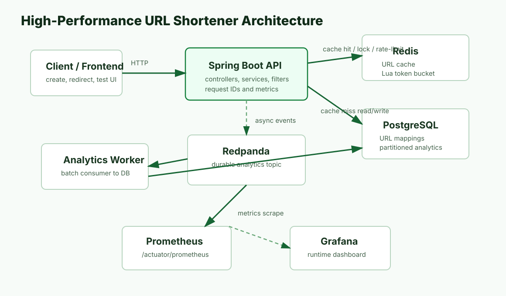
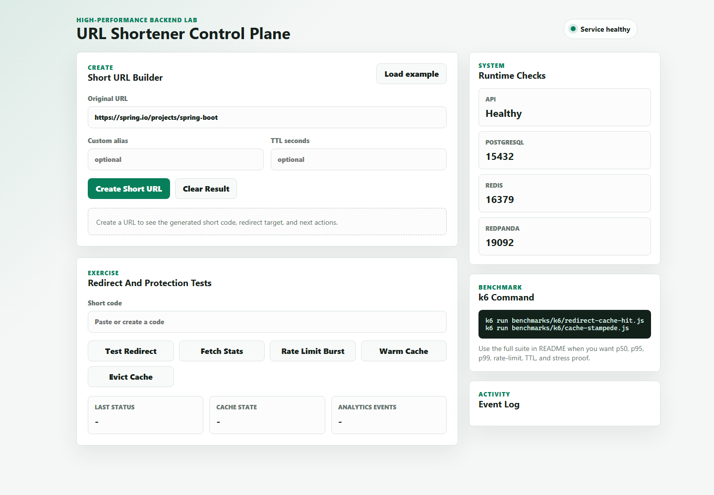

# High-Performance URL Shortener

Spring Boot 3 + Java 21 backend for a read-heavy URL shortener with Redis, PostgreSQL, Redpanda/Kafka analytics, Prometheus metrics, Grafana dashboards, and k6 benchmarks.

Oracle Always Free production uses Caddy, the built-in frontend/backend, PostgreSQL and Redis. It commits analytics to PostgreSQL before returning a redirect and protects general URL creation with a private key; the browser has a limited demo. See [deployment status](deploy/oracle/STATUS.md), [operations and retry commands](deploy/oracle/OPERATIONS.md), and [security audit](deploy/oracle/AUDIT.md). Public deployment is currently blocked by Hyderabad host capacity. The Kafka architecture and benchmark defaults below describe the development configuration.

## Architecture



```text
Client
  |
  | POST /api/v1/urls              GET /{shortCode}
  v                                v
Spring Boot API --------------> Redis URL cache
  |                                |
  | cache miss                     | token bucket Lua rate-limit state
  v                                v
PostgreSQL primary/read replica   Redpanda analytics topic
  |                                |
  | partitioned click events <-----+
  v
Prometheus <- /actuator/prometheus <- Grafana
```

Redirect hot path:

1. `RateLimitingFilter` checks a Redis Lua token bucket.
2. `UrlService.resolve` checks Redis by short code.
3. Cache hit returns `302 Found` without touching PostgreSQL.
4. Cache miss uses `lock:url:{shortCode}` stampede coordination, then reads PostgreSQL by indexed `short_code`.
5. Analytics are published asynchronously to Redpanda. Redirect does not wait for analytics persistence.

## Screenshots

Frontend control plane:



Grafana dashboard is provisioned from [observability/grafana/dashboards/url-shortener.json](observability/grafana/dashboards/url-shortener.json). After `docker compose up --build`, open `http://localhost:3000` and capture the `URL Shortener Runtime` dashboard.

## Features

- Create short URLs with optional custom aliases and TTL.
- Fast redirects through Redis-first resolution.
- PostgreSQL source of truth with Flyway migrations and indexes.
- Redis Lua token bucket rate limiting.
- Redis cache stampede protection with short lock TTL and double-check wait.
- Redpanda/Kafka durable analytics ingestion.
- Time-partitioned analytics tables.
- Read-replica routing hook for cache misses.
- Prometheus metrics and Grafana dashboard.
- Request ID correlation with `X-Request-ID`.
- Structured machine-readable error responses.
- Browser control plane for manual testing.
- k6 benchmark suite for p50/p95/p99 proof.

## Run

One command production-like stack:

```powershell
docker compose up --build
```

Developer mode:

```powershell
docker compose up -d postgres redis redpanda
mvn spring-boot:run
```

Services:

| Service | URL |
| --- | --- |
| API and frontend | `http://localhost:8081` |
| Prometheus | `http://localhost:9090` |
| Grafana | `http://localhost:3000` |
| PostgreSQL | `127.0.0.1:15432` |
| Redis | `127.0.0.1:16379` |
| Redpanda | `127.0.0.1:19092` |

Grafana login: `admin` / `admin`.

## API

Create short URL:

```http
POST /api/v1/urls
Content-Type: application/json
```

```json
{
  "originalUrl": "https://example.com/very/long/path",
  "customAlias": "optionalAlias",
  "ttlSeconds": 86400
}
```

Redirect:

```http
GET /{shortCode}
```

Returns `302 Found` with `Location: originalUrl`.

Stats:

```http
GET /api/v1/urls/{shortCode}/stats
```

Evict cache for benchmark proof:

```http
DELETE /api/v1/urls/{shortCode}/cache
```

## Database Schema

`url_mappings`

| Column | Purpose |
| --- | --- |
| `short_code` | unique lookup key for redirects |
| `original_url` | canonical redirect target |
| `created_at` | creation timestamp |
| `expires_at` | optional TTL expiry |
| `active` | soft-disable flag |

`analytics_events` is range-partitioned by `occurred_at` with monthly partitions such as `analytics_events_2026_06`, `analytics_events_2026_07`, and `analytics_events_2026_08`.

## Redis Strategy

- URL cache key: `url:{shortCode}`.
- Rate-limit state: `rl:tb:{client}:tokens` and `rl:tb:{client}:ts`.
- Stampede lock: `lock:url:{shortCode}`.
- Cache misses acquire the lock; competing callers wait briefly and double-check Redis.
- TTL URLs cache with matching TTL so expired mappings do not survive in Redis.

## Observability

Actuator:

```text
GET /actuator/health
GET /actuator/metrics
GET /actuator/prometheus
```

Prometheus metrics:

| Metric | Meaning |
| --- | --- |
| `url_redirect_total` | successful redirects, tagged by cache hit |
| `url_create_total` | created short URLs |
| `url_cache_hit_total` | Redis cache hits |
| `url_cache_miss_total` | Redis cache misses |
| `url_rate_limited_total` | token bucket rejections |
| `url_redirect_latency_seconds` | redirect latency histogram |
| `url_analytics_events_total` | analytics ingestion outcomes |
| `url_database_lookup_total` | PostgreSQL lookups after cache miss |

## Benchmarks

Run one scenario:

```powershell
k6 run benchmarks/k6/redirect-cache-hit.js
```

Run higher RPS:

```powershell
k6 run -e RPS=250 benchmarks/k6/redirect-cache-hit.js
```

Benchmark suite:

| Scenario | Script | Default RPS | Expected behavior |
| --- | --- | ---: | --- |
| Cache-hit redirect | `benchmarks/k6/redirect-cache-hit.js` | 80 | `0%` errors, p99 under `150ms` |
| Cache-miss redirect | `benchmarks/k6/redirect-cache-miss.js` | 100 | evicts cache, proves DB fallback |
| Create short URL | `benchmarks/k6/create-short-url.js` | 100 | writes URL mappings and warms cache |
| Rate-limit burst | `benchmarks/k6/rate-limit-burst.js` | 500 | expects `302` and intentional `429` |
| Cache stampede | `benchmarks/k6/cache-stampede.js` | shared 100 VUs | cold popular URL should produce near-one DB lookup |
| TTL expiry | `benchmarks/k6/ttl-expiry.js` | 1 iteration | expects `410 SHORT_URL_EXPIRED` |
| Analytics ingestion | `benchmarks/k6/analytics-ingestion.js` | 250 | redirects publish durable analytics events |
| Stress breaking point | `benchmarks/k6/stress-breaking-point.js` | ramps to 1500 | find saturation point |

Verified local benchmark results:

| Scenario | Run | Error Rate | p50 | p95 | p99 |
| --- | ---: | ---: | ---: | ---: | ---: |
| Cache-hit redirect | `80 RPS, 20s` | `0.00%` | `7.36ms` | `12.54ms` | `20.64ms` |
| Cache-miss redirect | `10 RPS, 15s` | `0.00%` | `9.66ms` | `11.88ms` | `13.04ms` |
| Create short URL | `50 RPS, 15s` | `0.00%` | `10.39ms` | `11.91ms` | `12.91ms` |
| Rate-limit burst | `500 RPS, 15s` | expected `302/429` | `1.06ms` | `2.13ms` | `6.31ms` |
| Cache stampede | `50 VUs, 50 cold hits` | `0.00%` | `31.53ms` | `97.80ms` | `97.80ms` |
| TTL expiry | `1 expired URL` | `0.00%` | `14.61ms` | `14.61ms` | `14.61ms` |
| Analytics queued redirect | `80 RPS, 15s` | `0.00%` | `4.17ms` | `5.45ms` | `6.12ms` |
| Stress ramp with default limiter | `250 -> 1000 target RPS, 40s` | `19.90%` protected by limiter | `2.08ms` | `3.49ms` | `4.86ms` |

Benchmark environment: local Windows machine, Java 21 packaged jar, PostgreSQL/Redis/Redpanda in Docker Desktop. Latency scenarios used a high rate-limit ceiling except the explicit rate-limit and stress runs.

## Design Decisions

| Decision | Why it matters |
| --- | --- |
| Redis-first redirects | keeps the common read path away from PostgreSQL |
| PostgreSQL as source of truth | Redis can be lost without losing canonical mappings |
| Redis Lua token bucket | refill and consume are atomic across app instances |
| Fail-open limiter on Redis failure | preserves availability when protection infrastructure is degraded |
| Async analytics | redirects do not wait for analytics persistence |
| Redpanda durable path | analytics can survive app restarts and traffic spikes |
| Partitioned analytics table | click data can scale and age out by time window |
| Cache stampede lock | cold popular URLs avoid many simultaneous DB reads |
| Request ID propagation | every response can be correlated with logs |
| Explicit error codes | clients and tests can assert behavior without parsing prose |

## Failure Handling

| Case | Status | Code |
| --- | ---: | --- |
| Invalid URL/body | `400` | `VALIDATION_FAILED` |
| Duplicate custom alias | `409` | `CUSTOM_ALIAS_ALREADY_EXISTS` |
| Expired short URL | `410` | `SHORT_URL_EXPIRED` |
| Missing short code | `404` | `SHORT_CODE_NOT_FOUND` |
| Rate limit exceeded | `429` | `TOO_MANY_REQUESTS` |
| Unexpected server error | `500` | `INTERNAL_SERVER_ERROR` |

Failure modes:

| Dependency / case | Behavior |
| --- | --- |
| Redis URL cache down | cache read/write logs warning, redirect falls back to PostgreSQL |
| Redis rate limiter down | limiter logs warning and allows request to preserve availability |
| PostgreSQL down | cache hits continue; cache misses and creates fail with server error |
| Redpanda down | publisher failure falls back to bounded local analytics queue when send cannot start |
| Analytics DB persistence fails | events are counted as dropped and logged; redirect path is not slowed |
| Duplicate alias | returns `409 CUSTOM_ALIAS_ALREADY_EXISTS` |
| Expired URL | returns `410 SHORT_URL_EXPIRED` |
| Missing short code | returns `404 SHORT_CODE_NOT_FOUND` |
| Cache stampede | one caller gets `lock:url:{shortCode}`; others wait briefly and re-check Redis |

## Testing

```powershell
mvn test
mvn -DskipTests package
```

Current suite:

| Test type | Coverage |
| --- | --- |
| Unit tests | URL service, code generation, validation, exception codes, filters, analytics fallback |
| Redis container tests | Lua token bucket and stampede lock behavior |
| Spring Boot Testcontainers | API flows against PostgreSQL, Redis, and Redpanda |
| Current local result | `45` tests discovered, `28` executed, `17` Testcontainers tests skipped because Java Testcontainers could not attach to Docker Desktop in this shell |

Manual testing:

- Browser control plane: `http://localhost:8081`
- Postman guide: [docs/POSTMAN_TESTING.md](docs/POSTMAN_TESTING.md)
- Teaching guide: [docs/PROJECT_TEACHING_GUIDE.md](docs/PROJECT_TEACHING_GUIDE.md)
- Elite extension notes: [docs/ELITE_EXTENSIONS.md](docs/ELITE_EXTENSIONS.md)
